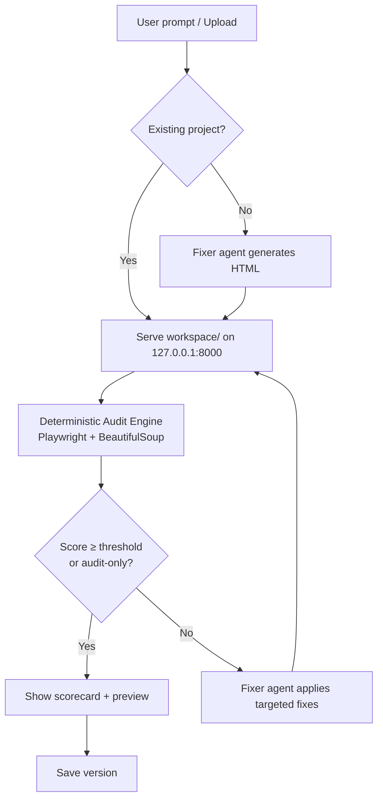

# AI UX Audit & Design Workspace

Local multi-agent system (CrewAI + Ollama Llama 3.2 + Playwright) that turns any static HTML project into a live UX auditing workspace.

## Features (assignment-ready)

- **Chat-style iterative workspace** (st.chat_input + session_state)
- **Deterministic audit engine** (missing alt, unlabeled inputs, heading order, viewport, mobile overflow, console errors) + scored report
- **Iterative improve-until-good loop** (audit → fix → re-audit, up to N times or score threshold)
- **Version history** with one-click restore
- **Localhost-only HTTP server** serving a dedicated `workspace/` folder (ZIP or HTML upload)
- **Responsive preview + download**
- **Scorecard UI** with expandable findings
- Fully offline after Ollama model download (except Tailwind CDN in generated pages)

## Architecture



## How to run

```bash
# 1. Install
pip install -r requirements.txt
playwright install chromium
# Make sure Ollama is running with llama3.2

# 2. From the src/ directory
cd src
streamlit run app.py
```

Upload a single HTML file or a ZIP of a static site. Then chat:  
“Audit this page” or “Fix the accessibility issues and make the button larger”.

## Mapping to the school assignment

| Requirement | How this project covers it |
|-------------|----------------------------|
| Agent that performs a concrete process | Multi-agent UX auditor + fixer that can judge and improve any static page |
| Offline or connection needed | Core pipeline is offline (Ollama + Playwright). Tailwind CDN needs internet only for generated previews. |
| Strengths | Deterministic checks give reliable numbers; iterative loop; version history; works on uploaded projects (not only generated) |
| Limitations | Small 3B model can still hallucinate HTML; no full React/Vite live server (upload the built static files); contrast checking is approximate |
| Technical / ethical questions | Local-only serving (privacy), generated code trust, copyright of AI designs, accessibility of AI output |
| Diagram / code sample | Mermaid above + `audit_engine.py` + CrewAI tasks |

## Next improvements (for the 15-min presentation)

- Planner agent for multi-section pages
- True offline Tailwind (vendor the CSS)
- “Apply this fix” buttons on each finding
- Benchmark runner with preset prompts
